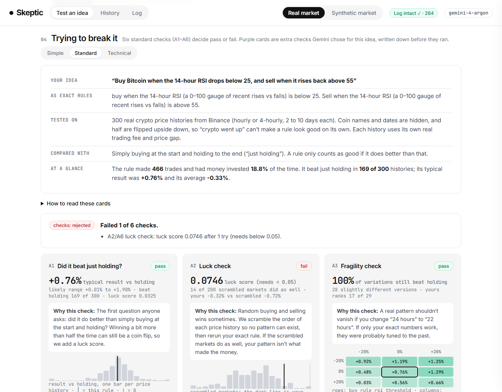
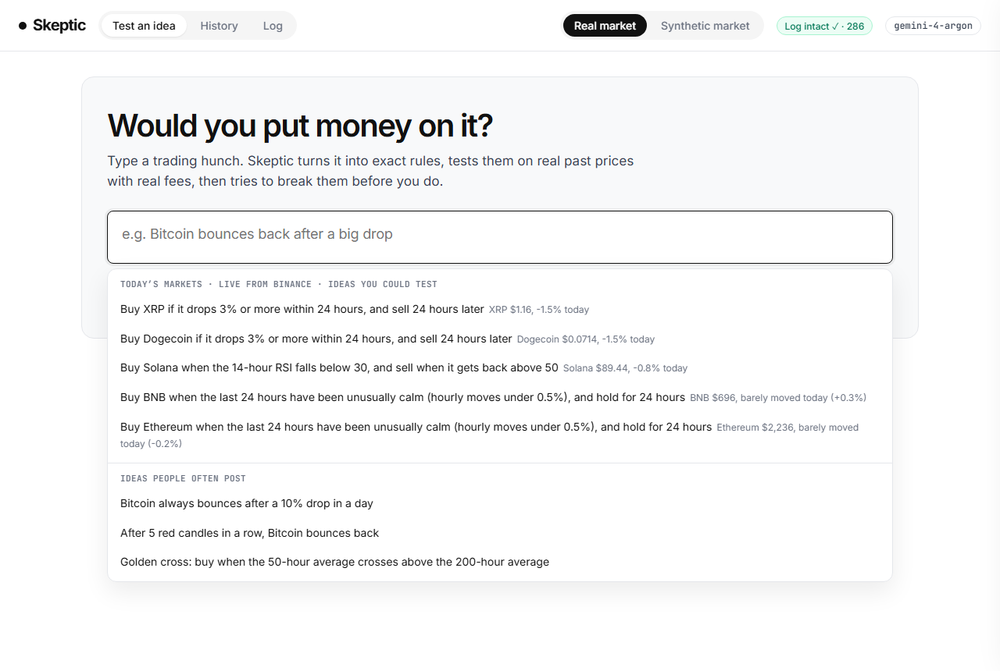
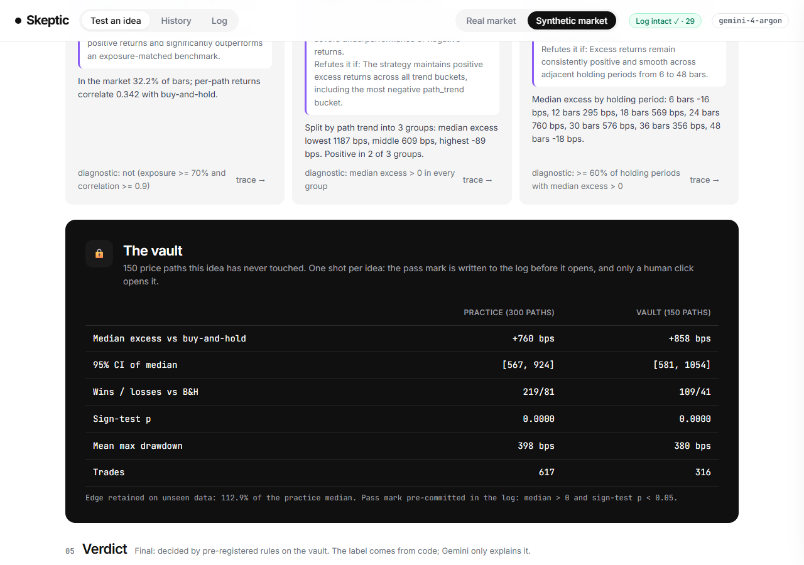
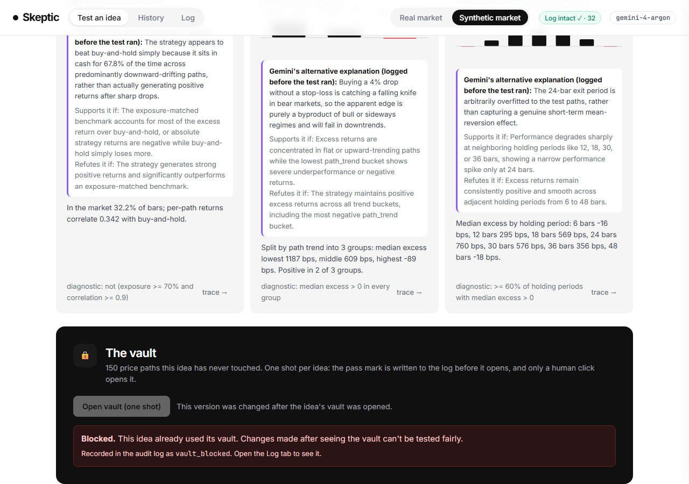

# Skeptic

**An AI reviewer that cross-examines trading ideas before you put money behind them.**

*Every trading bot here will tell you how much money it made. Ours tells you whether to believe it.*

**Who it's for:** someone with a trading hunch, such as a student, a UCL Trading Society member, or anyone trading crypto from their phone.
**The mistake it prevents:** believing a backtest that only looked good because of luck, over-tweaking, leaked future data or ignored fees, and then putting money behind it.

UCL AgentVerse 2026 · Finance track · paper trading only: there is no broker, exchange-order or real-money code anywhere in this repo.

> **Example.** Sam sees a post: *"My secret BTC strategy made +340% this year: buy when RSI(14) drops below 25, sell when it gets back above 55."* Skeptic tests that rule on 300 real price histories. It **beat just holding in 169 of 300**, which a normal backtest would call a winner. The **luck check** then found that **14 of 200 scrambled markets did just as well**, and **on average it lost 0.33% compared with just holding**. Verdict: **REJECTED**. The "+340%" claim never entered the test.



## How it works: Gemini does the talking, plain code does all the maths

```
 you type an idea ─► Gemini (gemini-4-argon) ─► clarifying questions ─► YOUR RULES, written down exactly (JSON)
 (or upload a post)    reads and translates only                                    │
                                                                       YOU approve ▼  (fingerprint, try counted)
 ┌──────────────────────── deterministic Python, integer pence / basis points ──────────────────────────┐
 │ A1 did it beat just holding?  A2 luck check  A3 fragility check  A4 higher fees  A5 lucky streaks      │
 │ A6 too many tries   ·   D1–D3: extra checks Gemini PICKED for this idea, its worry written down first    │
 │ pass mark set in skeptic/config.py ─► FINAL EXAM ("vault"): unseen prices, one attempt per idea,       │
 │                                       only YOU can open it, pass mark logged before it opens            │
 │ verdict SURVIVED / INCONCLUSIVE / REJECTED decided by code                                            │
 └──────────────────────────────────────────────────────────────────────────────────────────────────────┘
                        Gemini explains the verdict in plain words ─► NUMBER CHECK: every number it writes must
                                                                       match one the code produced (retry once,
                                                                       then cut the sentence and log it)
 every step ─► tamper-proof log (SHA-256 hash chain, logs/ledger.jsonl), "Log intact ✓" re-checked from disk
```

The model **never computes, edits or invents a number**, approves your rules, opens the final exam or moves a pass mark. It has no code path to do any of those.

### Plain names and technical names

The app and the deck use plain words. The evidence reports and the code use the technical names.

| In the app | ID | What it does, technically |
|---|---|---|
| Did it beat just holding? | A1 | Exact two-sided sign test vs buy-and-hold over all practice paths; median excess with a bootstrap 95% CI |
| Luck check | A2 | Surrogate permutation test: each path's one-bar returns shuffled K times, the exact rule rerun (DECISIONS D1) |
| Fragility check | A3 | Parameter sensitivity ±10/20/30% plus a 3×3 joint grid; ≥ 60% of neighbours must stay positive |
| Higher fees check | A4 | Strategy pays ×2 / ×3 fees and slippage, benchmark stays at ×1 (DECISIONS D2) |
| Lucky-streak check | A5 | Median must stay > 0 after dropping the top 5% of paths |
| Too many tries | A6 | Bonferroni: p_adj = min(1, p_perm × distinct versions tried) |
| Extra checks (purple) | D1–D3 | Diagnostics Gemini chose from a fixed menu, with the alternative explanation pre-registered in the log |
| Final exam | vault | One-shot holdout of 150 unseen paths with a pre-committed pass mark |
| Typical result · luck score | | Median excess vs buy-and-hold · sign-test or permutation p-value |

### Gemini models used (live calls through the Interactions API, `google-genai`)

| Model | Used for |
|---|---|
| `gemini-4-argon` | turning an idea into exact rules, plus clarifying questions (multi-turn, same interaction thread); picking extra checks and writing down its worry first; explaining the verdict under the number check; suggesting one simpler version; reading a screenshot or video of a trading claim |
| `gemini-3.5-flash-lite` | autocomplete: precise completions after a 400 ms pause |
| `gemini-3.8-flash` | configured as the fallback "fast" model |

Every call is logged with its interaction ID and token counts. Per-session call caps, timeouts and one retry on a fresh connection are enforced in `skeptic/agent.py`. Gemini is told to use plain words: "luck score", not "p-value"; "just holding", not "buy-and-hold"; percent, not basis points.

## Using the app

- **Start from today's market.** Click into the empty box for five ideas built from today's actual moves of big coins, for example *"Solana bounces back after any 3% dip · Solana $89.45, −1.0% today"*. Then type any coin ("pepe", "sui", "bitcoin") to search **about 1,000 live ideas across ~320–350 actively traded coins**. They come from Binance's free public 24-hour summary, turned into short everyday-language ideas by plain code, with no model involved. A note under them says what is true: every idea is tested on Skeptic's general set of past crypto prices, not on that coin's own history. They are display-only and never feed a test. They are offline-safe: if the venue Wi-Fi is down, you get the built-in examples instead (DECISIONS D8).
- **Or pick an idea people often post**, such as "Bitcoin always bounces after a 10% drop in a day", or type your own. Autocomplete matches your past ideas, the examples and today's ideas instantly. When you pause, Gemini finishes your sentence the way a person would ("…after a quick 10 percent flash crash"), with no rule syntax; the exact numbers come later, from its clarifying questions. If an idea looks like one you've already tested, an amber pill tells you the luck check will now be stricter.
- **Or upload a post or video** ("Check a post or video…"). Gemini quotes the claim and drafts the idea, and you still approve the rules.
- **Approve the rules.** They are shown exactly, with a plain-words sentence underneath, and every number is editable.
- **"Trying to break it"** opens with what was tested (your idea, the rules in plain words, the data, what "just holding" means, and the result at a glance). Switch between three levels of detail:
  - **Simple:** big number, pass or fail, and one sentence on why each check matters.
  - **Standard:** adds charts and summaries.
  - **Technical:** adds the exact method and raw numbers, for quant readers.
- **trace →** on any card shows where a number came from: data file hash → rule fingerprint → function → log entry → Gemini interaction IDs.



## Setup (Windows, Python 3.11+)

```powershell
py -3.11 -m venv .venv
.venv\Scripts\python.exe -m pip install -r requirements.txt
copy .env.example .env          # paste your Gemini API key: GEMINI_API_KEY=...
```

Then fetch the data with the AgentVerse kit (folder `agentverse/` dropped into this project, never committed). The commands are in [docs/COMMANDS.md](docs/COMMANDS.md#1-fetch-data-binance-vision-cc-by-nc-sa-40-never-committed). Then run:

```powershell
.venv\Scripts\python.exe -m uvicorn app.server:app --port 8000
.venv\Scripts\python.exe -m pytest           # 109 tests, no network or API key needed
```

Open http://127.0.0.1:8000. The server doesn't reload code by itself, so restart it after pulling changes.

## Two markets

The top-bar switch selects which data the app tests on:

- **Real market** (default): anonymised Binance Vision price windows fetched with the kit. Every result we report comes from here.
- **Synthetic market**: prices from our own generator (`skeptic/synthetic.py`) with a hidden "dip, then bounce back" pattern, so a real pattern exists to be found. It is always labelled as synthetic in the UI. On real data almost no simple idea survives (see below), so this is where the full final-exam flow can be shown working: pass, open the final exam, change a number, get blocked. It has its own log, try counts and final exam, and nothing crosses between the two markets (DECISIONS D6).

| Final exam opened (synthetic market) | Changed after the final exam: blocked and logged (synthetic market) |
|---|---|
|  |  |

## Evidence

Each piece is labelled as **independent** (judged by someone else's code or data we can't see) or **self-assessment** (we wrote both sides). Technical terms are used here because these rows mirror the reports in `results/`.

| | What | Result | Label |
|---|---|---|---|
| E1 | Engine parity: the kit's own runner vs our engine on 300 practice paths with a fixed rule | **300/300 identical** final cash and max drawdown; wins, losses, median excess, mean drawdown and sign-test p all identical ([results/parity](results/parity/parity_summary.json)) | correctness check |
| E2 | Known-answer test bank: 100 no-edge cases (random walks, real data, p-hacked best-of-50) plus 50 planted-pattern rules | **Skeptic approved 0/50, 0/30, 0/20 no-edge rules** (the naive screen approved 18%, 7%, 20%). Power rises with the true edge: 0% under 100 bps, 25% at 100–250 bps, 81% at 250–500 bps, 3/3 above 500 bps. Wilson 95% CIs throughout ([REPORT](results/testbank/REPORT.md)) | self-assessment |
| E3 | 10 frozen hunches, each run once through the kit's hidden `challenge --pack real-markets --cases 60` (seed committed before, revealed after) vs naive and Skeptic verdicts recorded beforehand | **0/10 had a significant hidden edge** (all sign-test p ≥ 0.245). Skeptic rejected 10/10. A naive win-rate screen would have approved 6, of which 3 lost to buy-and-hold on the hidden median and none was significant. No provenance warnings on any run ([REPORT](results/e3/REPORT.md)) | **independent** |
| E4 | Translation: 30 fully specified hunches with gold rule cards, 10 deliberately vague ones | **95% field-level exact match** (58/61); 24/26 whole cards exact; asked a clarifying question on **10/10** vague hunches ([REPORT](results/e4/REPORT.md)) | self-assessment (gold set should be reviewed by a teammate) |

What the real-market data says: on 300 practice paths, the best realistic hunches (dip-buying, RSI, mean-reversion) beat buy-and-hold on the **median** path (+40 to +90 bps), but their sign-test p-values are 0.09–0.33 and every one has a **negative mean** excess. A naive screen that looks at win rate would approve them. Skeptic rejects them. That is the product working.

### Reproduce every number

| Number | Command | Seeds |
|---|---|---|
| E1 parity | [docs/COMMANDS.md §3](docs/COMMANDS.md#3-e1-engine-parity-with-the-official-runner) | practice fetch seed 20261107 |
| E2 test bank | `.venv\Scripts\python.exe eval\testbank.py` (≈6 min, 12 workers) | fixed in `eval/testbank.py::build_cases` |
| E3 | `eval\run_e3.py prepare`, then the challenge commands in [COMMANDS §5](docs/COMMANDS.md#5-e3-certified-hunches-on-the-hidden-challenge), then `eval\run_e3.py table` | each run's `COMMITMENT.txt` + `SEED-REVEAL.txt` in `results/challenge/<fp>/` |
| E4 | `.venv\Scripts\python.exe eval\run_e4.py` (live Gemini; output varies run to run) | n/a |
| Any in-app number | the trace drawer ("trace →" on every card) | check seeds in `skeptic/config.py` |

The E2–E4 runs predate the plain-language wording, which changed only display text: no check, threshold or number changed.

## Safety rails (enforced in code)

- **You approve every rule, and only you can open the final exam.** The agent module has no function that reaches either (a test checks this).
- **One-shot final exam:** the pass mark is pre-committed in the log before the data is read. Re-opening replays the stored result. Any change after the final exam blocks the idea and marks it contaminated, and a contaminated idea can never get SURVIVED.
- **Try counter:** A6 makes the luck check stricter for every distinct version of an idea (Bonferroni). Autocomplete shows an amber warning, computed in code (token overlap), not by the model.
- **Number check** on every explanation Gemini writes.
- **Tamper-proof log:** editing any line makes the badge show "Log tampered ✗".
- **Limits:** an idea ≤ 1,000 characters, ≤ 5 conditions, look-backs ≤ 200 bars, permutation K ≤ 2,000, per-session model-call caps, 20 MB uploads. Each limit returns a clear error and logs `limit_hit`.
- **Live market data is suggestion text only.** It never reaches a test, the final exam or `adapter.py` (a test checks this).
- **Prompt-injection hygiene:** user text is wrapped as data, and there are no tools to abuse.
- The Google builder guide bans *"autonomous financial trading tools without deterministic verification checks and human approval gates."* Skeptic is built around exactly those two things.

## Limits and honest caveats

- Rules are simple: buy with all the money, later sell it all; price only; one asset; bar-based. That is what the kit's runner can execute.
- The bar interval is hidden (1h or 4h), so the rules assume **1 bar = 1 hour**.
- Practice and final-exam windows are drawn from the same pool of coins and months, so some may overlap in time. The kit's hidden challenge (E3) is the stronger, independent test.
- E2 and E4 are self-assessments. Synthetic random walks are not markets.
- The A2 luck check differs from the spec: the spec's random-entry permutation was miscalibrated (22.5% false positives on null data), so we use a shuffled-returns test (6%). See [docs/DECISIONS.md](docs/DECISIONS.md) D1, and D2–D8 for the other deviations.
- Today's-market ideas need internet and use live prices, but they are only suggestions. Testing always uses the fetched historical data.
- **Nothing here is a claim of real-world profitability.** Backtests and the hidden challenge are past data.

## Repo map

```
skeptic/   config · spec (rule DSL) · features · engine · stats · data · attacks · vault · ledger · verdict
           pipeline · agent (Gemini) · numberguard · synthetic · markets · cli
app/       server.py (FastAPI) · today.py (~1,000 today's-market ideas, display only) · static/ (vanilla JS UI, no build step)
adapter.py JSONL adapter the kit's runner calls (frozen rules, no LLM, no network)
eval/      compare_parity · certify · testbank · run_e3 · run_e4 · translation_gold.json · e3_hunches.json
results/   committed evidence (parity, testbank, e3, e4, challenge reports)
docs/      COMMANDS.md (every kit command) · DECISIONS.md (D1–D8) · SPEC.md · STATUS.md
data/      hunch_library.json (our example ideas; everything else in data/ is gitignored)
```

## Data attribution

Historical price data: **Binance Vision** public data, CC BY-NC-SA 4.0, fetched locally with the AgentVerse kit for non-commercial educational use. It is never redistributed: `data/` is gitignored, and committed challenge reports contain aggregate results only. Today's-market suggestions read Binance's public 24-hour market summary live and store nothing. This project is not endorsed by Binance.
