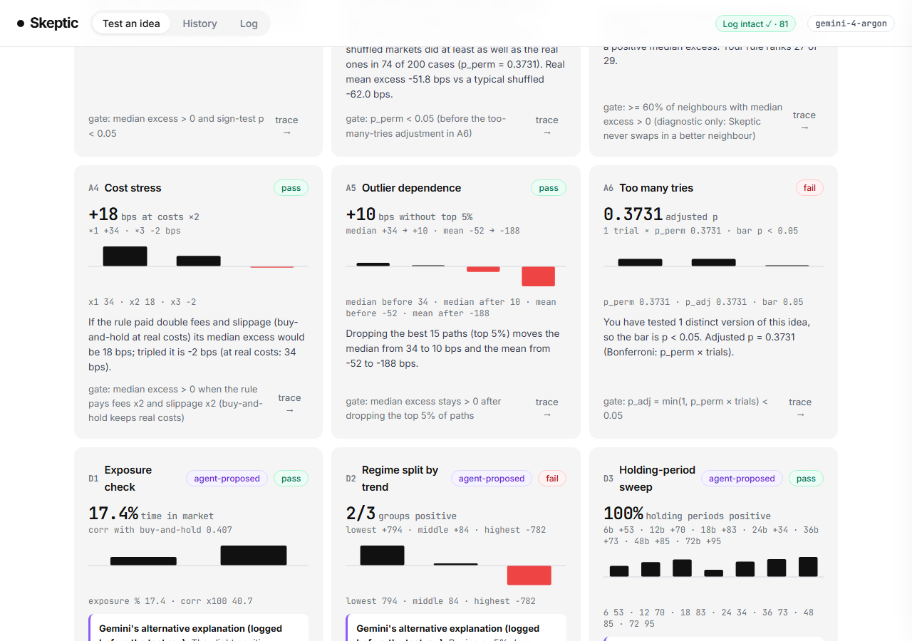

# Skeptic

**An AI reviewer that cross-examines trading ideas before you put money behind them.**

*Every trading bot here will tell you how much money it made. Ours tells you whether to believe it.*

**Who it's for:** a trader testing a hunch, such as a UCL Trading Society member or a retail crypto trader.
**The failure it prevents:** believing a backtest that only looked good because of luck, over-tweaking, leaked future data or ignored costs, and then trading it.

UCL AgentVerse 2026 · Finance track · paper trading only: there is no broker, exchange-order or real-money code anywhere in this repo.



## How it works: the LLM stops where the maths starts

```
 trader types a hunch ──► Gemini (gemini-4-argon) ──► clarifying questions ──► RULE CARD (JSON)
                          translates text only                                     │
                                                                    HUMAN approves ▼ (fingerprint, trial counted)
 ┌─────────────────────────────── deterministic Python, integer pence / bps ───────────────────────────────┐
 │ A1 baseline   A2 shuffled-returns   A3 wobble   A4 cost stress   A5 outliers   A6 too-many-tries          │
 │ D1–D3: diagnostics Gemini CHOSE and PRE-REGISTERED (alternative explanation + supports/refutes)           │
 │        from the A1 summary only, logged before they ran                                                  │
 │ practice gate (thresholds in skeptic/config.py) ──► vault: one shot per idea, HUMAN click only,           │
 │                                                    pass mark pre-committed to the log before it opens      │
 │ verdict label SURVIVED / INCONCLUSIVE / REJECTED decided by code                                         │
 └──────────────────────────────────────────────────────────────────────────────────────────────────────────┘
                          Gemini explains the verdict ──► NUMBER GUARD: every number in the text must match a
                                                          tool output (regenerate once, then strip + log)
 every step ──► append-only, SHA-256 hash-chained ledger (logs/ledger.jsonl), "Log intact ✓" re-verified from disk
```

The model **never computes, edits or invents a number**, approves a rule card, opens the vault or changes a threshold. It has no code path to do any of those.

### Gemini models used (live calls through the Interactions API, `google-genai`)

| Model | Used for |
|---|---|
| `gemini-4-argon` | turning a hunch into a rule card plus clarifying questions (multi-turn, same interaction thread); choosing and pre-registering diagnostics; explaining the verdict under the number guard; suggesting one cleaner hypothesis; reading a finfluencer clip or screenshot (video/image to hunch) |
| `gemini-3.5-flash-lite` | autocomplete layer 2: precise completions after a 400 ms pause |
| `gemini-3.8-flash` | configured as the fallback "fast" model |

Every call is logged with its interaction ID and token counts. Per-session call caps, timeouts and one retry on a fresh connection are enforced in `skeptic/agent.py`.

## Setup (Windows, Python 3.11+)

```powershell
py -3.11 -m venv .venv
.venv\Scripts\python.exe -m pip install -r requirements.txt
copy .env.example .env          # paste your Gemini API key: GEMINI_API_KEY=...
```

Then fetch the data with the AgentVerse kit (folder `agentverse/` dropped into this project, never committed). The commands are in [docs/COMMANDS.md](docs/COMMANDS.md#1-fetch-data-binance-vision-cc-by-nc-sa-40-never-committed). Then run:

```powershell
.venv\Scripts\python.exe -m uvicorn app.server:app --port 8000
.venv\Scripts\python.exe -m pytest           # 95 tests
```

Open http://127.0.0.1:8000.

## Two markets

The top-bar switch selects which data the app tests on:

- **Real market** (default): anonymised Binance Vision price windows fetched with the kit. Every result we report comes from here.
- **Synthetic market**: prices from our own generator (`skeptic/synthetic.py`) with a planted "dip, then rebound" pattern, so an edge exists to be found. It is always labelled as synthetic in the UI. On real data almost no simple hunch survives (see below), so this is where the full vault flow can be shown working: pass, open the vault, tweak a parameter, get blocked. It has its own ledger, trial counts and vault, and nothing crosses between the two markets.

| Vault opened (synthetic market) | Tweak after the vault: blocked and logged (synthetic market) |
|---|---|
|  |  |

## Evidence

Each piece is labelled as **independent** (judged by someone else's code or data we can't see) or **self-assessment** (we wrote both sides).

| | What | Result | Label |
|---|---|---|---|
| E1 | Engine parity: the kit's own runner vs our engine on 300 practice paths with a fixed rule | **300/300 identical** final cash and max drawdown; wins, losses, median excess, mean drawdown and sign-test p all identical ([results/parity](results/parity/parity_summary.json)) | correctness check |
| E2 | Known-answer test bank: 100 no-edge cases (random walks, real data, p-hacked best-of-50) plus 50 planted-pattern rules | **Skeptic approved 0/50, 0/30, 0/20 no-edge rules** (the naive screen approved 18%, 7%, 20%). Power rises with the true edge: 0% under 100 bps, 25% at 100–250 bps, 81% at 250–500 bps, 3/3 above 500 bps. Wilson 95% CIs throughout ([REPORT](results/testbank/REPORT.md)) | self-assessment |
| E3 | 10 frozen hunches, each run once through the kit's hidden `challenge --pack real-markets --cases 60` (seed committed before, revealed after) vs naive and Skeptic verdicts recorded beforehand | **0/10 had a significant hidden edge** (all sign-test p ≥ 0.245). Skeptic rejected 10/10. A naive win-rate screen would have approved 6, of which 3 lost to buy-and-hold on the hidden median and none was significant. No provenance warnings on any run ([REPORT](results/e3/REPORT.md)) | **independent** |
| E4 | Translation: 30 fully specified hunches with gold rule cards, 10 deliberately vague ones | **95% field-level exact match** (58/61); 24/26 whole cards exact; asked a clarifying question on **10/10** vague hunches ([REPORT](results/e4/REPORT.md)) | self-assessment (gold set should be reviewed by a teammate) |

What the real-market data says: on 300 practice paths, the best realistic hunches (dip-buying, RSI, mean-reversion) beat buy-and-hold on the **median** path (+40 to +90 bps), but their sign-test p-values are 0.09–0.33 and every one has a **negative mean** excess. A naive screen that looks at win rate would approve them. Skeptic rejects them. That is the product working.

### Reproduce every number

| Number | Command | Seeds |
|---|---|---|
| E1 parity | [docs/COMMANDS.md §3](docs/COMMANDS.md#3-e1-engine-parity-with-the-official-runner) | practice fetch seed 20261107 |
| E2 test bank | `.venv\Scripts\python.exe eval\testbank.py` (≈6 min, 12 workers) | fixed in `eval/testbank.py::build_cases` |
| E3 | `eval\run_e3.py prepare`, then the challenge commands in [COMMANDS §5](docs/COMMANDS.md#5-e3-certified-hunches-on-the-hidden-challenge), then `eval\run_e3.py table` | each run's `COMMITMENT.txt` + `SEED-REVEAL.txt` in `results/challenge/<fp>/` |
| E4 | `.venv\Scripts\python.exe eval\run_e4.py` (live Gemini; output varies run to run) | n/a |
| Any in-app number | the trace drawer ("trace →" on every card): raw file SHA-256 → rule fingerprint → function → ledger seq + hash → Gemini interaction IDs | attack seeds in `skeptic/config.py` |

## Risk controls (enforced in code)

- **Human gates:** only a human click approves a rule card or opens the vault. The agent module has no function that reaches either (a test checks this).
- **One-shot vault:** the pass mark is pre-committed in the ledger before the data is read. Re-opening replays the stored result. Any change after the vault blocks the idea and marks it contaminated, and a contaminated idea can never get SURVIVED.
- **Trial counter:** A6 adjusts p for every distinct version of an idea (Bonferroni). Autocomplete shows an amber "N variants tested" pill computed in code (token overlap), not by the model.
- **Number guard** on every explanation.
- **Hash-chained, append-only log:** editing any line makes the badge show "Log tampered ✗".
- **Limits:** a hunch ≤ 1,000 characters, ≤ 5 conditions, look-backs ≤ 200 bars, permutation K ≤ 2,000, per-session model-call caps, 20 MB uploads. Each limit returns a clear error and logs `limit_hit`.
- **Prompt-injection hygiene:** user text is wrapped as data, and there are no tools to abuse.
- The Google builder guide bans *"autonomous financial trading tools without deterministic verification checks and human approval gates."* Skeptic is built around exactly those two things.

## Limits and honest caveats

- Rules are long-only, all-in/all-out, price-only and bar-based, because that is what the kit's runner can execute.
- The bar interval is hidden (1h or 4h), so rule cards assume **1 bar = 1 hour**.
- Practice and vault windows are drawn from the same pool of symbols and months, so some may overlap in time. The kit's hidden challenge (E3) is the stronger, independent test.
- E2 and E4 are self-assessments. Synthetic random walks are not markets.
- The A2 test differs from the spec: the spec's random-entry permutation was miscalibrated (22.5% false positives on null data), so we use a shuffled-returns test (6%). See [docs/DECISIONS.md](docs/DECISIONS.md) D1, and D2–D7 for the other deviations.
- **Nothing here is a claim of real-world profitability.** Backtests and the hidden challenge are past data.

## Repo map

```
skeptic/   config · spec (rule card DSL) · features · engine · stats · data · attacks · vault · ledger · verdict
           pipeline · agent (Gemini) · numberguard · synthetic · markets · cli
app/       server.py (FastAPI) · static/ (vanilla JS UI, no build step)
adapter.py JSONL adapter the kit's runner calls (frozen rule card, no LLM)
eval/      compare_parity · certify · testbank · run_e3 · run_e4 · translation_gold.json · e3_hunches.json
results/   committed evidence (parity, testbank, e3, e4, challenge reports)
docs/      COMMANDS.md (every kit command) · DECISIONS.md · SPEC.md · STATUS.md
```

## Data attribution

Price data: **Binance Vision** public data, CC BY-NC-SA 4.0, fetched locally with the AgentVerse kit for non-commercial educational use. It is never redistributed: `data/` is gitignored, and committed challenge reports contain aggregate results only. This project is not endorsed by Binance.
